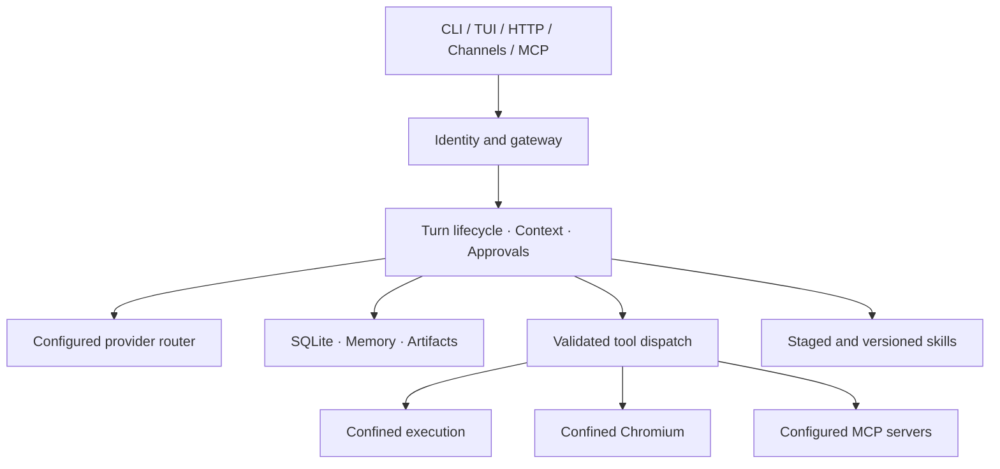

<div align="center">


# LayerAgent

**Your projects. Your models. Your execution policy.**

A local and self-hosted engineering agent with persistent memory,<br />
confined tools, a terminal workspace and an extensible integration layer.


[Quick start](#quick-start) · [Capabilities](#capabilities) · [Security](#security-model) · [Documentation](#documentation) · [Español](docs/12-guia-rapida-es.md)

</div>

---

> **Linux development release.** The first version targets Linux. Run native confinement qualification on the actual deployment host; source and fixture checks alone do not certify it. macOS and Windows execution are disabled and are outside this first release. See the [implementation matrix](docs/10-implementation-status.md).
>
> This repository is the standalone project. Install from source using the instructions below; prebuilt release downloads are not provided yet.

## Contents

- [Cooperative investigation](#cooperative-investigation)
- [What LayerAgent does](#what-layeragent-does)
- [Capabilities](#capabilities)
- [Architecture](#architecture)
- [Requirements](#requirements)
- [Install from source](#install-from-source)
- [Quick start](#quick-start)
- [Models and providers](#models-and-providers)
- [Configuration and privacy](#configuration-and-privacy)
- [Tools and approvals](#tools-and-approvals)
- [Browser](#browser)
- [Memory and skills](#memory-and-skills)
- [MCP and messaging](#mcp-and-messaging)
- [HTTP API and self-hosting](#http-api-and-self-hosting)
- [Backups and recovery](#backups-and-recovery)
- [Command reference](#command-reference)
- [Security model](#security-model)
- [Development and verification](#development-and-verification)
- [Troubleshooting](#troubleshooting)
- [Documentation](#documentation)
- [Roadmap and license](#roadmap-and-license)

## What LayerAgent does

LayerAgent connects a model to an engineering workspace through a durable, policy-controlled runtime. Use it to inspect a repository, implement a change, run project checks, investigate an artifact or carry a task across sessions.

The same engine powers the CLI, animated TUI, authenticated HTTP API, MCP server and messaging adapters. History, memory, tool outcomes and approvals belong to the runtime, so each interface does not need a separate agent implementation.

- **Work in a project:** inspect files, search code, edit with stale-content checks and review observed diffs.
- **Keep control:** scope filesystem and network access, approve external operations and cancel active work.
- **Choose your model:** use configured remote providers or a compatible local endpoint.
- **Continue later:** reopen durable sessions and retrieve scoped historical facts.
- **Extend deliberately:** add custom tools, scoped project-files MCP and reusable verified skills.
- **Inspect evidence:** retain hashes, artifacts and observed/inferred/unknown analysis records.

## Cooperative investigation

Create a temporary team whose analyst, reviewer and verifier consult each other,
challenge a premise and preserve the evidence behind a changed conclusion. The
CLI and TUI expose members, questions, delivery states, findings and budget use.
Cooperative teams currently investigate read-only workspaces.

Try the reproducible local demonstration after building the CLI:

```bash
python3 tests/cooperative_smoke.py
python3 tests/cooperative_tui_smoke.py
```

The demo uses a scripted loopback provider and no API key. Its default result is
explicitly inconclusive; the optional native variant runs a confined check before
discarding the hypothesis. See the [terminal team guide](docs/15-cooperative-terminal.md)
for activation, controls, exports and the limits of this evidence.

## Capabilities

| Area | Included in the development implementation | Qualification |
| --- | --- | --- |
| Terminal | CLI, adaptive TUI, streamed text/tool output, approvals and animated mascot | Automated layout and real PTY smoke tests |
| Runtime | Typed lifecycle, session/workspace serialization and cooperative cancellation | Fixture and executable tests; broader task evaluation remains |
| Tools | Files, shell/PTY, protected Git operations and custom JSON tools | Execution requires verified native confinement |
| Subagents | Scoped children, shared budgets, concurrency and writable isolated worktrees | Scripted-model validation |
| Cooperative teams | Direct durable messaging, read-only roles, terminal panel, pause/resume and evidence export | Scripted provider and explicit native qualification; real-model quality remains unqualified |
| Models | Five wire adapters, authorized fallback and circuit breakers | Live provider compatibility must be qualified separately |
| Memory | SQLite WAL/FULL, FTS5/BM25, revisions and optional vector retrieval | Lexical retrieval has no model-download requirement |
| Skills | Progressive discovery, staged fixtures, promotion, versions and rollback | Promotion requires a working sandbox |
| Browser | Dedicated Chromium, isolated profile, DOM tools, screenshots and network/console inspection | Linux confinement required; host attach/visible fallback disabled |
| Integrations | Verified project-files MCP adapter, owner MCP server and messaging connectors | Arbitrary MCP servers require effective restrictions before enablement |
| Remote bridge | Signed/encrypted jobs, mTLS runners, PostgreSQL leases and local effect receipts | Linux personal/self-hosted; qualify each deployment host |
| Analysis | Native metadata, entropy, hash-linked evidence and analyzer bridges | External analyzers are optional dependencies |
| Recovery | Durable effect intent, interrupted-state reconciliation and uncertain deliveries | Unknown effects require reconciliation before retry |
| Backup | Authenticated encrypted snapshots, manifest verification and new-home restore | Offline workflow; private identity kept separately |

A feature listed here may still have release gates. [Status and boundaries →](docs/10-implementation-status.md)

## Architecture



| Crate | Responsibility |
| --- | --- |
| `layeragent-cli` | Executable, daemon lifecycle and terminal clients |
| `layeragent-ui` | TUI views, theme, layout and mascot rendering |
| `layeragent-protocol` | Shared messages, events, schemas and redaction |
| `layeragent-config` | Layered configuration, policy and validation |
| `layeragent-core` | Orchestration, approvals, context and child agents |
| `layeragent-providers` | Model protocols, streaming, routing and OAuth |
| `layeragent-tools` | Tool schemas, dispatch, Git and MCP client |
| `layeragent-sandbox` | Native execution, process/resource control and proxy |
| `layeragent-browser` | Chromium lifecycle, DevTools and page operations |
| `layeragent-storage` | SQLite, retrieval, artifacts and encrypted backups |
| `layeragent-skills` | Discovery, fixtures, promotion and rollback |
| `layeragent-gateway` | IPC, HTTP, streams, messaging and MCP server |
| `layeragent-rea` | Artifact inspection, evidence and analyzer bridges |
| `layeragent-policy` | MCP grants, catalog pinning and Linux file-effect broker |
| `layeragent-remote` | Pairing, encrypted jobs, PostgreSQL coordinator and runners |

## Requirements

| Dependency | Required for | Notes |
| --- | --- | --- |
| Rust **1.99.0** | Building | Pinned by `rust-toolchain.toml` |
| C compiler/linker | Building native dependencies | Bundled SQLite and TLS-related build dependencies |
| Python **3.11+** | Confined file tools, verification and source packaging | Uses isolated interpreter mode for file tooling |
| Node **22** | Building the shared frontend | The current Vite release requires Node 22; Node 18 fails the engine check |
| Tauri system packages | Building the desktop application | `libwebkit2gtk-4.1-dev`, `libayatana-appindicator3-dev`, `librsvg2-dev`, `libxdo-dev` |
| Linux + Bubblewrap | Shell/browser execution | User/network/PID namespaces must actually work |
| Landlock ABI 3 | Linux execution policy | Diagnose with `layeragent doctor` |
| Model endpoint | Inference | Configured remote service or running local server |
| Chromium | Browser tools | System/explicit executable or managed installation |
| ONNX Runtime | Optional embeddings | Only for the embedding-enabled build |
| Analyzer programs | Optional artifact bridges | Installed independently |

**Platform support:** Linux is the current execution target, subject to host preflight and native tests. macOS/Windows source and cross-checks are experimental; execution remains blocked until certified. A successful build does not prove kernel confinement.

## Install from source

Clone the repository and build the CLI:

```bash
git clone https://github.com/maxilagv/agent-layer.git layeragent
cd layeragent
rustup toolchain install 1.99.0 --profile minimal --component rustfmt --component clippy
cargo build --release --locked -p layeragent-cli
./target/release/layeragent --version
./target/release/layeragent doctor
```

For a Debian/Ubuntu development host, common build prerequisites are:

```bash
sudo apt-get update
sudo apt-get install -y build-essential pkg-config python3 bubblewrap
```

Host policy can still prevent namespaces after installation. If `doctor` identifies an AppArmor restriction, review the scoped profiles and installer under [`deploy/apparmor/`](deploy/apparmor/). An administrator must review/install the required policy. Do not disable host-wide security or Chromium's sandbox.

Optionally install the built executable into your user binary directory:

```bash
install -Dm755 target/release/layeragent "$HOME/.local/bin/layeragent"
```

Add that directory to your shell's `PATH` if necessary. Bubblewrap, Python and optional analyzer tools remain external runtime dependencies; this is not a universal static binary.

## Quick start

### 1. Configure an installed local model

Start your compatible local model server first, then choose a model identifier and context window it actually supports:

```bash
layeragent init \
  --protocol ollama \
  --base-url http://127.0.0.1:11434 \
  --model YOUR_INSTALLED_MODEL \
  --context-window 32768
```

`init` without model options creates an empty configuration. It refuses to overwrite an existing one.

### 2. Open a workspace

```bash
layeragent run "Inspect this project, explain its architecture and run the relevant checks" \
  --workspace /absolute/path/to/project

layeragent tui --workspace /absolute/path/to/project
```

Running `layeragent` without a subcommand opens the TUI. Clients start the private shared daemon when needed. The runtime home must remain outside the workspace.

### 3. Continue or stop

```bash
layeragent sessions
layeragent resume SESSION_ID "Continue from the previous findings"
layeragent stop
```

Use `--json` with `run` or `resume` for machine-readable output. Cancellation and completed session history are distinct: stopping work does not delete the session.

## Models and providers

| Protocol | Configure `wire` / `--protocol` | Credentials |
| --- | --- | --- |
| Responses-compatible | `openai_responses` | Environment reference or supported OAuth registration |
| Chat Completions-compatible | `openai_chat` | Provider-dependent |
| Anthropic Messages | `anthropic` | Environment reference or supported OAuth registration |
| Gemini | `gemini` | Environment reference or supported OAuth registration |
| Ollama | `ollama` | Local service configuration |

OpenRouter, DeepSeek, vLLM and other services may use a compatible adapter with their own endpoint/model IDs. Compatibility is qualified per service; it is not implied for every extension or model feature.

Example remote setup, with the credential already supplied securely in your environment:

```bash
layeragent init \
  --protocol openai_responses \
  --base-url https://api.openai.com/v1 \
  --model YOUR_MODEL_ID \
  --key-env OPENAI_API_KEY \
  --context-window 32768
```

Do not put the credential value into the command, prompt or configuration. For an officially supported OAuth public-client registration:

```bash
layeragent auth login PROVIDER_NAME
layeragent auth logout PROVIDER_NAME
```

See [provider routing](docs/07-multi-provider-resilience-and-model-routing.md) for fallback, native metadata and cost limits.

## Configuration and privacy

Configuration merges **defaults → `config.toml` → `profiles/NAME.toml`**. Select a profile with `--profile NAME`. Choose the runtime home with `--home PATH` or `LAYERAGENT_HOME`; otherwise the platform configuration directory is used.

```bash
layeragent config validate
layeragent config explain
layeragent config schema
layeragent models
```

A conservative policy example:

```toml
[policy]
shell = true
write = true
network = false
approval_tools = ["shell"]
timeout_secs = 300
max_output_bytes = 1048576

[policy.limits]
cpu_secs = 120
file_size_bytes = 268435456
open_files = 256
cgroup = false

[privacy]
local_models_only = true
allowed_providers = ["primary"]

[browser]
enabled = false
```

`local_models_only` constrains model destinations, including fallbacks. For completely offline operation, also disable/restrict browser access, remote MCP, channels and tool networking. Leave optional embeddings disabled or preinstall their model artifacts to avoid model downloads. `init` names its provider/model alias `primary`; the separate annotated example names its local provider `local`. `allowed_providers = []` permits explicitly configured providers; a nonempty list narrows that set.

Tool networking and model networking are independent. Confined tool networking additionally requires `policy.network = true`, explicit `allow_domains` and a supporting sandbox host. Memory/pid/cgroup ceilings are workload-specific and fail closed when requested but unavailable.

The [annotated configuration](examples/config.toml) includes providers, tools, hooks, MCP and channels. Authority changes cancel active/queued work and expire approvals. Invalid reloads retain the last valid snapshot.

## Tools and approvals

| Tool family | Examples | Control |
| --- | --- | --- |
| Workspace | Read, list, search, write and edit | Path validation, protected paths, stale-content checks |
| Execution | Shell and interactive PTY | Native confinement, limits and optional shell approval |
| Git | Status/diff, brokered stage/commit | Protected metadata; writes require approval |
| Browser | Open/search, DOM interaction, screenshots | Domain policy; external actions require approval |
| MCP/custom | Reviewed project-files MCP and JSON subprocess tools | Explicit MCP grants, effective broker checks and concrete approval |
| Memory/skills | Retrieve/revise facts, load/draft/verify skills | Scope and isolated promotion policy |
| Delegation | Spawn/wait/cancel/list children | Parent authority, tree budget and worktree isolation |
| Analysis | Inspect artifacts and invoke installed analyzers | Evidence records and confined external programs |

Approvals include an argument digest, expiry and destination. CLI and TUI provide a complete, scrollable review of arguments and context; approval stays blocked until the full record has been displayed. Browser action contexts are rechecked after approval. Detected target changes invalidate the action; page text and scripts remain untrusted.

Custom tools receive JSON on stdin and run inside the execution policy. `pre_tool_call` hooks must return `{"allow": true}`; failure rejects the call. A skill, hook or model response cannot expand the operator's policy.

## Browser

```bash
layeragent browser status
layeragent browser install
layeragent browser open https://example.com
```

The agent uses its own temporary Chromium profile. Tools can read snapshots, interact with numbered DOM elements, capture PNG artifacts and inspect network/console evidence. Traffic goes through the configured proxy and private network destinations are rejected.

The Linux browser requires outer namespace confinement and Chromium's own sandbox. Unsafe `no_sandbox`, host-browser attachment and visible-mode fallbacks are rejected in the current hardened build. The retained options are not permission to bypass confinement.

Cookies/logins do not persist between turns. Multiple tabs, authenticated persistent profiles and model vision consuming screenshots remain roadmap work. Search results depend on the configured search page and can fail if its markup or access policy changes.

## Memory and skills

SQLite WAL/FULL stores scoped history, facts and tool outcomes. FTS5/BM25 retrieval works without downloading a model. Optional local embeddings add HNSW/rank-fusion retrieval:

```bash
cargo build --release --locked -p layeragent-cli --features embeddings
```

Install compatible ONNX Runtime and configure `ORT_DYLIB_PATH` when required before enabling `memory.embeddings`. Embedding models may be downloaded into the private cache. Missing embedding support degrades to lexical retrieval with an explicit event.

```bash
layeragent memory "Previous architecture decisions" --workspace /path/to/project
layeragent skills list
layeragent skills verify SKILL_NAME
layeragent skills versions SKILL_NAME
layeragent skills rollback SKILL_NAME --hash ARCHIVED_VERSION_HASH
```

Skills are staged, fixture-tested in isolation and versioned before promotion. Detected credentials reject a draft. Independent general quality evaluation is still needed: a passed fixture establishes only that fixture's behavior.

## MCP and messaging

LayerAgent exposes its runtime through `layeragent mcp` (stdio) and the owner-only HTTP `/mcp` endpoint (`layeragent_run`, `layeragent_sessions`). Its initial verified client integration is the application-owned **project-files** adapter, with grants per identity, project, tool, operation and destination.

```bash
layeragent remote grant --root /srv/projects/demo --project demo \
  --operations read --destinations docs --out grant.json
layeragent remote project-files --grant grant.json
```

To enable that adapter inside the agent, use `adapter = "project-files"` plus the explicit generated grant under `[mcp.NAME]`; do not set `command` or `url`. Legacy arbitrary HTTP/stdio servers are disabled until their effect restrictions can be verified. Tool names and annotations never confer authority. [Permission model and configuration →](docs/14-remote-execution-and-mcp-trust.md)

The encrypted remote bridge has separate mTLS identities, explicit pairing, project-bound grants, PostgreSQL assignments, 60-second maximum leases and local durable receipts. Runners connect outward; model credentials stay on the authorized computer. [Install, pair, operate and recover →](docs/14-remote-execution-and-mcp-trust.md)

Messaging connector code supports Telegram, Discord, Matrix and Signal. Slack/WhatsApp use signed webhooks; WhatsApp subscription verification uses a separate verification secret. Sender/workspace grants are explicit. Matrix encrypted rooms need a decrypting bridge, and Signal needs `signal-cli`.

Live platform tests need credentials. Uncertain outgoing deliveries are retained as `unknown` for reconciliation rather than blindly repeated.

## Web and desktop interfaces

The same runtime is reachable from a browser and from a desktop window. Both
read the same persisted state, so a task started in one place is visible in
the others.

```bash
# Guided installation (resumable; saves progress atomically)
layeragent setup

# Loopback web interface; prints a single-use access code
layeragent web --bind 127.0.0.1:9474

# Shared frontend (Node 22 is required)
export PATH="$HOME/.local/node22/bin:$PATH"
cd frontend && npm install && npm run build && npm test
```

The browser never holds a bearer token: it uses a single-use code, an
`HttpOnly` session cookie and a CSRF token. The desktop shell talks to the
daemon over its UNIX socket with bounded commands and no shell or general
file access. See [Web, frontend and desktop →](docs/15-web-and-desktop-interfaces.md).

## HTTP API and self-hosting

Supply `LAYERAGENT_TOKEN` securely in the process environment, then:

```bash
layeragent serve
```

The default bind is `127.0.0.1:9473`. HTTP uses Bearer authentication. An example request using an existing environment value:

```bash
curl --fail-with-body \
  --header "Authorization: Bearer ${LAYERAGENT_TOKEN}" \
  http://127.0.0.1:9473/v1/sessions
```

| Route | Purpose |
| --- | --- |
| `/v1/sessions` | List/create scoped sessions |
| `/v1/sessions/{id}/turns` | Execute with SSE events |
| `/v1/sessions/{id}/events` | Read durable events |
| `/v1/sessions/{id}/ws` | WebSocket observation |
| `/v1/jobs/{id}/cancel` | Cancel an owned job |
| `/v1/approvals/{id}` | Resolve an approval |
| `/v1/schema` | Inspect the public protocol |
| `/mcp` | Owner-only MCP |

Global configuration/reload and shutdown require the actual owner identity. Delegated scopes cannot impersonate it. Gateway admission, body sizes, request rates, running jobs and streaming lifetimes are bounded.

[`deploy/layeragent.service`](deploy/layeragent.service) is an optional Linux **user service** template. It expects the binary at `~/.local/bin/layeragent` and a private service environment file under the runtime configuration directory. Review memory/process limits and credential references before installation:

```bash
install -Dm644 deploy/layeragent.service "$HOME/.config/systemd/user/layeragent.service"
systemctl --user daemon-reload
systemctl --user enable --now layeragent.service
```

Create the referenced private environment file first. Use TLS termination for remote access and preserve correct host/origin routing. A single self-hosted service is not a certified public multi-tenant SaaS, a desktop app or a fleet certified for hostile tenants. Use the separate encrypted remote coordinator for project runners; it does not broaden the local owner gateway.

## Backups and recovery

Stop every runtime/profile using the same home. Generate a private age identity outside both the runtime home and project directory:

```bash
layeragent backup keygen --identity /secure/location/backup.identity
```

Save the printed public recipient, then:

```bash
layeragent stop
layeragent backup create --output /backups/layeragent-backup-00000000000000000001.age --recipient YOUR_AGE_RECIPIENT
layeragent backup verify --archive /backups/layeragent-backup-00000000000000000001.age --identity /secure/location/backup.identity
layeragent backup restore --archive /backups/layeragent-backup-00000000000000000001.age --identity /secure/location/backup.identity --destination /new/private/layeragent-home
layeragent backup retain --directory /backups --keep 7
```

Archives use authenticated encryption and per-file manifests. Restore requires a new destination and rejects wrong keys, tampering, unsafe paths and configured archive limits. Configuration references, consistent SQLite snapshots, artifacts and supported skill state are included. Runtime sockets, caches, service environment files and keyring logins are excluded.

Keep the private identity separately and test restoration. Reconnect credentials and review project paths afterwards. Optional [maintenance scripts/timer](docs/13-backup-and-recovery.md) automate offline snapshot windows; they do not replace restoration drills.

After a crash, an uncertain tool or delivery remains uncertain. Inspect the external state before authorizing another operation.

## Command reference

Global options: `--home PATH`, `--profile NAME`.

| Command | Purpose |
| --- | --- |
| `init` | Create configuration without overwriting an existing file |
| `setup` | Guided, resumable installation: host, provider, credential, connection, isolation, browser |
| `run PROMPT --workspace PATH` | Execute through the shared runtime |
| `resume ID PROMPT` | Continue a stored session |
| `tui --workspace PATH` | Open the terminal interface |
| `web --bind ADDRESS` | Serve the shared web interface on a loopback address |
| `sessions` | List operator sessions |
| `stop` | Stop local runtime work |
| `doctor [--json]` | Diagnose execution prerequisites |
| `config validate / explain / schema` | Inspect configuration and contracts |
| `models` | List configured models |
| `auth login / logout PROVIDER` | Use configured official OAuth |
| `browser status / install / open URL` | Manage/test the browser |
| `memory QUERY --workspace PATH` | Search scoped historical facts |
| `skills list / verify / versions / rollback` | Manage reusable procedures |
| `rea inspect / ledger / verify / seal` | Inspect artifacts and evidence |
| `serve` | Start authenticated HTTP plus private runtime transport |
| `mcp` | Expose runtime tools over stdio |
| `remote` | Project grants, pairing, encrypted jobs, runners, activity TUI and revocation |
| `backup keygen / create / verify / restore / retain` | Manage encrypted snapshots |
| `completions SHELL` | Generate shell completions |

Use `layeragent --help` and `layeragent COMMAND --help` for exact arguments.

## Security model

LayerAgent treats model output, repository files, web content, tool replies and retrieved facts as untrusted inputs. Security boundaries must be enforced by code and the host, not by a model agreeing to a prompt.

| Control | Scope | Limit |
| --- | --- | --- |
| Native confinement | Workload files/processes/network | Requires an actually supported kernel/host policy |
| Identity/workspace grants | API and messaging access | Not hostile-tenant VM isolation |
| Concrete approvals | External operations and sensitive tools | Cannot certify the intent of an untrusted website |
| Credential redaction | Registered values and supported plaintext patterns | Not universal DLP, OCR or encoded-secret detection |
| Replay reconciliation | Avoid blind repetition of uncertain effects | Operator/external evidence may be required |
| Evidence chain | Detect changes relative to trusted checkpoints | Does not resist a controlling administrator |
| Encrypted backups | Confidentiality/integrity of snapshots | Private identity loss is unrecoverable |

See [`SECURITY.md`](SECURITY.md) for threat boundaries, reporting and operational limitations. Updating does not retroactively sanitize old databases, exports or backups.

## Development and verification

```bash
cargo install cargo-deny --version 0.20.2 --locked
cargo fmt --all --check
cargo clippy --workspace --all-targets --locked -- -D warnings
cargo test --workspace --locked
cargo check -p layeragent-cli --features embeddings --locked
cargo build -p layeragent-cli --locked
python3 tests/verify.py
```

The integrated verifier records the maintained source fingerprint and rejects evidence if inputs change while checks run. It includes real executable transport/authentication/TUI, backup, plaintext-handling and recovery smokes, plus source-distribution hygiene and signing tests. Signing tests require **OpenSSL 3** and use disposable keys only.

Bounded, deterministic randomized tests exercise Unicode/byte fragmentation, credential redaction, signed native blocks and malformed/mixed-delimiter provider frames. These are repeatable stress/property tests, not a coverage-guided fuzzing campaign.

Run full native checks explicitly on a supporting host:

```bash
sudo sh deploy/apparmor/install.sh  # where scoped AppArmor profiles are required
sudo -v
python3 tests/verify.py --native
LAYERAGENT_BROWSER_HELPER="$PWD/target/debug/layeragent" \
  cargo test -p layeragent-browser --test live --locked -- --ignored --test-threads=1
```

The native runner uses an explicitly delegated transient systemd service (systemd 254+); administrator authentication must be available in that terminal. It does not disable host-wide protections. The network positive control and browser search require Internet access; Chromium may need a first-use download. `doctor` marks unavailable optional capabilities as warnings; requested cgroup limits remain mandatory.

Ignored checks and host failures are recorded separately. Fixtures make no paid-provider requests; live provider/platform qualification is separate. Dependency checks use `cargo deny` and [`deny.toml`](deny.toml); any advisory exceptions must identify an exact scope and rationale.

Measure tasks against a running daemon with the conditions of the run
recorded alongside the numbers:

```bash
python3 tests/benchmark_tasks.py --home ~/.layeragent --samples 5 \
  --output docs/task-benchmark.json
```

A live measurement requires configured provider prices, caps the tokens of
every request and stops before the budget would be exceeded. A p95 that
cannot be qualified is published as `not qualified` instead of a number. See
[Task measurement →](docs/16-task-measurement.md).

An opt-in real-model check exercises MiniMax through Vercel AI Gateway, including streaming, daemon restart and an optional confined tool call. Create a private `.env` **outside** this source directory with `AI_GATEWAY_API_KEY`, then:

```bash
python3 tests/live_provider.py --run --env-file /external/private/.env \
  --tool-check --coding-check --report /external/private/live-report.json
```

`--coding-check` adds a tiny confined Python correction/test task with immutable tests and an independent static check. This consumes real provider usage. The configured budget is a per-turn runtime estimate, not a global account spending limit. Use `--self-test` for offline credential-parser checks. Direct MiniMax API keys and Vercel AI Gateway keys use different endpoints; do not interchange them. See [Vercel's compatible API documentation](https://vercel.com/docs/ai-gateway/sdks-and-apis/openai-chat-completions).

Prepare a **local source-only review bundle**:

```bash
python3 scripts/prepare_release.py --output /tmp/layeragent-source.tar.gz
```

The archive includes source checksums and a dependency inventory. It excludes build/runtime state and does not invoke Git, publish packages or upload anything. [Contribution guide →](CONTRIBUTING.md)

Future maintainers can attach an Ed25519 signature with [`scripts/sign_source.py`](scripts/sign_source.py), using an independently managed private key outside the project. Recipients must authenticate the public key separately; the exported key and unsigned JSON metadata do not establish trust. No trusted release key or signed public release exists yet.

## Troubleshooting

| Problem | Next step |
| --- | --- |
| `Failed RTM_NEWADDR` / namespace permission error | Run `doctor`; review kernel/AppArmor support and scoped profile installation |
| cgroup controller unavailable | Configure service delegation before requesting cgroup limits |
| Model connection failure | Check endpoint, model ID, context size and credential reference |
| Privacy policy rejects fallback | Restrict fallback list or explicitly authorize its provider |
| HTTP 401 / 403 | Check actual token identity, owner-only route, grants and Origin |
| HTTP 429 / 503 | Review rate/connection/job capacity and existing streams |
| Approval expires | Reconnect after policy changes or refresh the changed action target |
| Text appears at completion | Incomplete logical lines are buffered for fragmented-secret protection |
| Embeddings unavailable | Check feature build, ONNX Runtime and model artifacts |
| Backup says home is busy | Stop every profile/daemon using that home |
| Interrupted/unknown effect | Reconcile the external state before retrying |

## Documentation

| Guide | Contents |
| --- | --- |
| [Product specification](PRODUCT.md) | Principles, scope, roadmap and acceptance criteria |
| [01 · Architecture and isolation](docs/01-architecture-and-kernel-isolation.md) | Crate boundaries, Linux confinement and platform limits |
| [02 · Lifecycle and recovery](docs/02-core-fsm-and-turn-lifecycle.md) | State transitions, effects, cancellation and approvals |
| [03 · Gateway and integrations](docs/03-omnichannel-gateway-and-event-mesh.md) | API, identity, channels and MCP |
| [14 · Remote execution and MCP trust](docs/14-remote-execution-and-mcp-trust.md) | Installation, pairing, permissions, queue, revocation and recovery |
| [04 · Memory and storage](docs/04-episodic-memory-and-knowledge-graph.md) | WAL, retrieval, revisions and embeddings |
| [05 · Skills](docs/05-self-evolving-skills-and-metacognition.md) | Staging, fixtures, promotion and versions |
| [06 · Context and budgets](docs/06-context-engineering-and-token-budgeting.md) | Instruction scope, compaction and accounting |
| [07 · Providers and privacy](docs/07-multi-provider-resilience-and-model-routing.md) | Adapters, credentials, fallback and outbound policy |
| [08 · Artifact analysis](docs/08-reverse-engineering-discipline-and-evidence-engine.md) | Inspection, analyzers and evidence boundaries |
| [09 · Public references](docs/09-comprehensive-reading-list-and-references.md) | Primary technical documentation |
| [10 · Implementation status](docs/10-implementation-status.md) | Evidence, open gates and exact support limits |
| [11 · Configuration and operations](docs/11-configuration-and-operations.md) | Policy, HTTP deployment and troubleshooting |
| [12 · Guía en español](docs/12-guia-rapida-es.md) | Instalación y uso inicial en español |
| [13 · Backup and recovery](docs/13-backup-and-recovery.md) | Encrypted snapshots, retention and restoration |
| [15 · Web, frontend and desktop](docs/15-web-and-desktop-interfaces.md) | Loopback web surface, shared frontend, desktop shell and their authority limits |
| [16 · Task measurement](docs/16-task-measurement.md) | Measured times, cost rules, budget guard and qualified percentiles |

## Roadmap and license

The immediate goal is a reliable local/self-hosted engineering agent. Upcoming product areas include guided onboarding, richer project/change review, desktop/web clients, production qualification of the encrypted remote bridge and independently qualified team isolation.

Stable releases are gated by native confinement, platform qualification, recovery evidence and representative task evaluations. Scope and acceptance criteria live in [`PRODUCT.md`](PRODUCT.md).

**MIT © 2026 LayerAgent contributors.** See [`LICENSE`](LICENSE). Optional models, browsers and analyzer tools have their own licenses and installation requirements.
