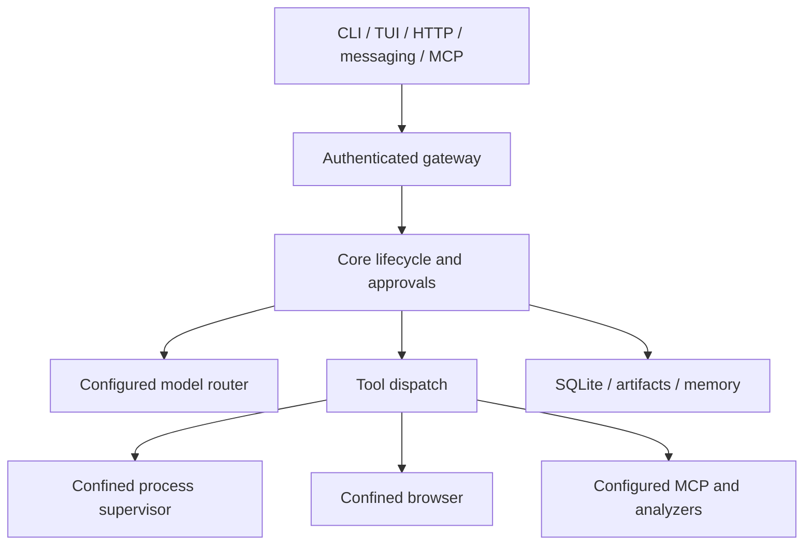

# 01 · Architecture and execution isolation

LayerAgent separates clients, orchestration, data and execution into thirteen Rust crates. `layeragent-core` owns turn lifecycle; clients communicate through `layeragent-protocol` and `layeragent-gateway`.



## Linux execution

| Layer | Responsibility | Source |
| --- | --- | --- |
| Mount plan | Minimal runtime, allowed read/write roots, protected metadata | `layeragent-sandbox/src/plan.rs` |
| Namespace supervisor | Filesystem, process and network namespaces | `layeragent-sandbox/src/lib.rs` |
| Inner helper | Landlock, seccomp, resource ceilings and exec | `layeragent-sandbox/src/inner.rs` |
| Network broker | Host-side destination validation and proxy | `layeragent-sandbox/src/proxy.rs` |
| Resource groups | Optional delegated cgroup v2 ceilings | `layeragent-sandbox/src/cgroup.rs` |
| Interactive processes | Owner-scoped PTY lifecycle | `layeragent-sandbox/src/pty.rs` |
| Browser helper | Outer confinement while retaining Chromium sandbox | `layeragent-sandbox/src/browser.rs` |

Helpers dispatch before the multithreaded Tokio runtime is constructed. They must not inherit a multithreaded runtime into confinement setup. Cancellation terminates the owned process group and bounded output prevents memory amplification.

## Operating-system requirements

Shell/browser execution needs working Bubblewrap user namespaces and the required Landlock ABI. Some distributions restrict unprivileged namespaces with AppArmor. `deploy/apparmor/install.sh` contains a narrowly scoped administrator-installed profile; `doctor` diagnoses availability. Do not disable host-wide protections to work around failures.

macOS and Windows backend code is experimental and production execution remains disabled pending native validation. Windows restricted tokens/Job Objects alone do not establish the promised read boundary.

## Verification

```bash
cargo test -p layeragent-sandbox --locked
cargo test -p layeragent-cli --test native --locked
cargo test -p layeragent-cli --test native --locked -- --ignored
```

The non-ignored helper tests exercise individual kernel controls. The ignored suite requires a supported host and exercises the full namespace path. Passing one does not imply passing the other. See [status](10-implementation-status.md).

For CI on a systemd 254+ Linux host, `python3 scripts/run_native_tests.py` builds the exact test executable and runs it in a temporary delegated service. Administrator access and the scoped AppArmor profile must already be available. This prepares cgroup controllers without weakening host-wide restrictions and reports any qualification failure. The CI definition is not evidence of a successful remote run.
