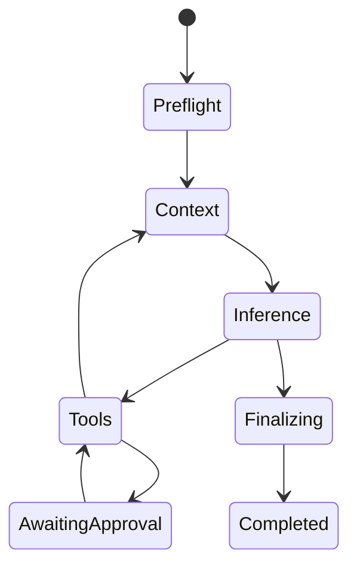

# 02 · Core lifecycle, approvals and recovery

The core serializes sessions and workspaces, compiles context, requests model inference, dispatches validated tools and records results. Type-level transition edges restrict the turn graph; this is not formal verification of the complete agent.

Cancellation/failure can terminate an active phase. Authority changes cancel active and queued work and invalidate pending approvals. Child agents share a sticky tree budget and concurrency limits; writable children use isolated Git worktrees.

## Effect safety

| Record | Meaning |
| --- | --- |
| Tool intent | Call identity and exact-argument digest recorded before execution |
| Sanitized arguments | Display/replay copy with detected secrets removed |
| Completed result | Durable outcome available for replay |
| Unknown result | Runtime cannot prove whether an effect completed |
| Interrupted turn | Work stopped before a complete final response |

Original arguments reach the authorized executor unchanged. Sanitized copies must never replace execution inputs. Different original arguments remain distinct even if their redacted representation is identical.

On restart, running tools, processing inbox messages and sending outbox deliveries become uncertain. The runtime does not automatically repeat uncertain effects. Reconcile them using external evidence before beginning another action.

## Approvals

Approval events identify the call, argument digest, configured destination and expiry. Both terminal clients show the complete bounded review with page navigation and refuse approval until every review row has been displayed; undersized screens and oversized reviews fail closed. Browser interactions capture a target context and check it again after approval. An observed changed target invalidates the action. Page scripts can still mutate during execution; page text is never authority.

## Verification

`crates/layeragent-core/tests/runtime.rs` exercises cancellation, persistence, uncertainty and scripted delegation. `tests/system_smoke.py` drives the executable, daemon, fixture provider and SQLite. Real-model effectiveness and unsupported platform execution require separate evidence.
