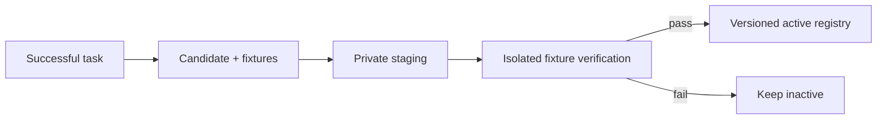

# 05 · Skills and bounded learning

A skill is a directory with `SKILL.md`, optional support files and deterministic fixtures. Discovery exposes metadata first; bodies load on demand. External skills cannot certify themselves.



## Lifecycle

| Command | Purpose |
| --- | --- |
| `layeragent skills list` | Discover current skills |
| `layeragent skills verify NAME` | Exercise fixtures and promote a valid draft |
| `layeragent skills versions NAME` | Inspect archived versions |
| `layeragent skills rollback NAME --hash HASH` | Restore an archived version |

Successful multi-step tasks may trigger bounded synthesis. Candidates need explicit fixtures and a working sandbox before promotion. Drafts containing detected credentials are rejected before writing. Registry leases prevent concurrent promotion/rollback races.

## Catalogs and guides

Skills from elsewhere, and guides that have no fixtures, wait in quarantine
until you have read and accepted them; quarantined skills are never offered to
the agent.

| Command | Purpose |
| --- | --- |
| `layeragent skills import PATH` | Quarantine every skill found below a directory |
| `layeragent skills import https://...` | Clone a public Git repository without history and quarantine its skills |
| `layeragent skills quarantine` | List what waits, with its source, files and scripts |
| `layeragent skills review NAME` | Print the `SKILL.md`, its files, scripts and links |
| `layeragent skills accept NAME` | Activate it (archiving an active version of the same name) |
| `layeragent skills reject NAME` | Drop it |

An import refuses symlinks, secret-looking paths, files over 1 MiB, skills
over 5 MiB or 200 files, and text that contains detected credentials; files
are copied without execute bits. The `SKILL.md` format with `name` and
`description` frontmatter is the common one, and extra frontmatter keys are
ignored. An accepted skill is marked `reviewed`; if its files change it is no
longer the version you accepted and stops being marked. A skill the agent
drafts without fixtures (a guide, such as a project's design rules) goes to
quarantine the same way, and `skill_verify` tells it the operator accepts it.

The agent finds skills with `skill_search`, which ranks active skills by
name, description and body, and lists matching quarantined ones as waiting for
you. A starter catalog of guides ships in
[examples/skills](../examples/skills/README.md): project kickoff, stack choice,
cost control, cinematic web pages, three.js 3D and storefronts.

## Authoring

```markdown
---
name: inspect-build
description: Inspect a project build using reproducible commands.
---

# Inspect build

Record the build command, its exit status and relevant diagnostics.
```

Document prerequisites, commands, expected evidence and failure handling. Fixtures should compare meaningful independent inputs and outputs. A fixture that only checks a successful exit cannot establish the general correctness of a procedure.

Learning never expands tool permissions or authorizes external effects. Broad effectiveness evaluation and richer registry administration remain future work.
