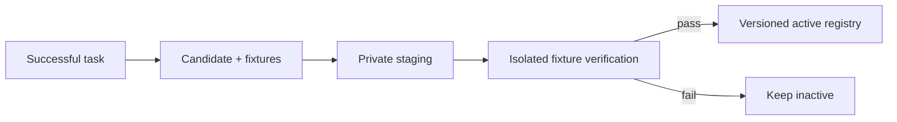

# 05 · Skills and bounded learning

A skill is a directory with `SKILL.md`, optional support files and deterministic fixtures. Discovery exposes metadata first; bodies load on demand. External skills cannot certify themselves.



## Lifecycle

| Command | Purpose |
| --- | --- |
| `layeragent skills list` | Discover current skills |
| `layeragent skills verify NAME` | Exercise fixtures and promote a valid draft |
| `layeragent skills versions NAME` | Inspect archived versions |
| `layeragent skills rollback NAME --hash HASH` | Restore an archived version |

Successful multi-step tasks may trigger bounded synthesis. Candidates need explicit fixtures and a working sandbox before promotion. Drafts containing detected credentials are rejected before writing. Registry leases prevent concurrent promotion/rollback races.

## Authoring

```markdown
---
name: inspect-build
description: Inspect a project build using reproducible commands.
---

# Inspect build

Record the build command, its exit status and relevant diagnostics.
```

Document prerequisites, commands, expected evidence and failure handling. Fixtures should compare meaningful independent inputs and outputs. A fixture that only checks a successful exit cannot establish the general correctness of a procedure.

Learning never expands tool permissions or authorizes external effects. Broad effectiveness evaluation and richer registry administration remain future work.
