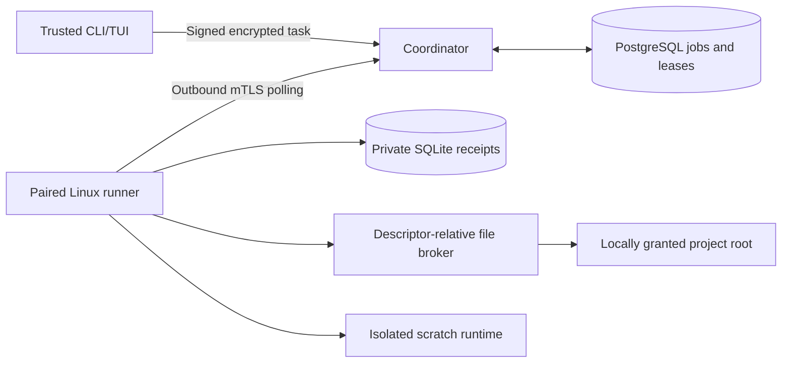

# 14 · MCP permissions and encrypted remote execution

LayerAgent's remote bridge is a Linux, personal, self-hosted control plane. It
uses the existing CLI/TUI, a PostgreSQL coordinator and project-bound runners.
The initial verified MCP integration is the application-owned project-files
adapter. Arbitrary HTTP/stdio integrations remain disabled until an adapter can
enforce their real effects. A tool's name, description or `readOnlyHint` never
creates a permission.

## Components and trust



The coordinator never executes job programs and has neither the owner's signing
key, job decryption keys nor model credentials. Scheduling metadata includes
account/project/device/runner IDs, operation classes, deadlines, sizes and timing.
It is not anonymous storage. Model calls happen on the runner; the explicitly
selected provider receives the model request. Transport encryption does not
replace local authorization.

| Boundary | Enforced behavior |
| --- | --- |
| Account/project | Owner-signed job, enrolled recipient, pinned local grant and matching revisions |
| Runner | mTLS leaf-certificate fingerprint, separate signing/encryption keys, protocol/runtime version and limits |
| MCP tool | Application-owned schema, approved catalog hash, exact operation and relative destination prefixes |
| Filesystem | Pinned root identity, `openat2` beneath/no-symlink/no-magic-link/no-mount-crossing resolution, regular files without hardlink aliases |
| File effects | Broker authorization at dispatch and commit; per-operation Landlock ABI 3 workers reject forbidden new write access and commits through moved parents |
| Processes | Native namespaces, Landlock, seccomp, cgroups and a scratch workspace; no arbitrary host command received from the cloud |
| Recovery | Intent before effects, durable receipts, attempt/generation fencing and explicit uncertain outcomes |

Use **a distinct unprivileged Linux service account per project runner** when
protecting projects from a compromised supervisor. Do not install several scope
identities and their keys under one mutually readable Unix account and claim
host-level isolation. A root/kernel compromise can expose that host's scopes;
revocation cannot erase data or secrets already delivered to a compromised host.
Capability/version declarations are not remote attestation.
The coordinator and runner refuse to start as UID 0. Provision their service
accounts first; administrator access is for installation, not running jobs.

The file broker is trusted code. Its narrow API resolves input paths against the
grant; its Landlock workers additionally restrict writes. The broker retains the
read access needed to inspect local authority configuration. Untrusted model
programs execute in the separate native sandbox, not inside that broker.

## Requirements and private layout

Requirements are Linux with `openat2`, fully enforced Landlock ABI 3, the existing
native sandbox prerequisites, systemd 254+ with delegated memory/pids/cpu
controllers for execution, PostgreSQL 18 and OpenSSL 3 for the provisioning helper.
Keep real-time clocks synchronized: signed deadline validation allows 30 seconds
of clock tolerance, while local lease duration uses the suspend-aware monotonic
clock. File-only runners do not spawn job programs; they still require the real file
broker controls. No unsupported-host fallback is available.

Keep every key, grant, enrollment, configuration and receipt directory outside
the project roots. Private JSON/key files must be regular, owned by the process
account, mode `0600`, without hardlink aliases. Private directories should be
`0700`. Public TLS certificates may be world readable. Create private files with
`umask 077` and transfer enrollment files with their permissions preserved.

Reference configurations are in [examples/remote](../examples/remote/):

| File | Runs on | Important setting |
| --- | --- | --- |
| `coordinator.json` | Server | Account, fresh epoch, owner public key/certificate and independent authority checkpoint |
| `client.json` | Trusted operator computer | Owner keys and mTLS identity |
| `runner.json` | Project computer | Accepted enrollment, local root grant, model allowlist and named command templates |

The initial coordinator is a **single logical authority**, with a PostgreSQL
session lock rejecting a second active coordinator for the same database.
Database transitions use transactions and an advisory lock. This deliberately
favors an auditable personal deployment over a high-throughput/HA scheduler.

PostgreSQL must be reached over a local Unix socket or explicit loopback IP.
There is no unencrypted remote-database fallback. Use a dedicated non-superuser
database role and a database it owns; PostgreSQL durability settings must retain
`fsync` and synchronous commit. A typical peer-authenticated setup is:

```bash
sudo -u postgres createuser --no-superuser --no-createdb --no-createrole layeragent-coordinator
sudo -u postgres createdb --owner=layeragent-coordinator layeragent
```

The coordinator service environment contains a connection reference, for example:

```text
LAYERAGENT_REMOTE_DATABASE=host=/var/run/postgresql dbname=layeragent user=layeragent-coordinator
```

Review the service templates [coordinator](../deploy/layeragent-coordinator.service)
and [project runner](../deploy/layeragent-runner@.service) before installing them.
Create their accounts/directories, install the executable at the template path
and assign private files to the corresponding service UID. Run initialization
once as that UID before enabling the persistent coordinator service. The
coordinator terminates mTLS directly; forwarded headers do not establish identity.

## Provision TLS and application keys

For a personal bootstrap, the helper creates a new private directory, offline CA
and separate coordinator/owner/runner TLS identities:

```bash
umask 077
python3 scripts/remote_pki.py --directory /secure/location/new-pki --hostname gateway.example.com
```

It never installs trust or uploads keys. Certificates expire after 30 days. Keep
`ca.key` offline and off the coordinator. Provision only the appropriate leaf
key/certificate and the public CA to each endpoint. For production enrollment,
prefer runner-generated CSRs signed on the trusted CA computer.

Generate the owner's application keys on the trusted client, and the runner's
application keys on its own computer:

```bash
layeragent remote keygen --keys owner.keys.json --certificate owner.pem --public owner.public.json
layeragent remote keygen --keys runner.keys.json --certificate runner.pem --public runner.public.json
```

Commands print **public** identity metadata only. Place the owner signing key and
owner certificate hash from `owner.public.json` in the coordinator configuration.
Generate a fresh UUID for its `epoch`, and put the same account/epoch in the
client configuration. Its checkpoint parent must already be private and owned
by the coordinator UID.

```bash
layeragent remote coordinator --config coordinator.json --initialize
```

Subsequent starts omit `--initialize`. No bearer master token is shared with
runners. TLS identity, application signatures and encryption have separate roles.

## Pair a project runner

On the runner computer, create a request with a 10-minute expiry:

```bash
layeragent remote pair-request --keys runner.keys.json --certificate runner.pem \
  --account personal --project demo --runner linux-demo-1 --device linux-workstation \
  --out pairing-request.json
```

Transfer the request to the trusted client. Compare its displayed fingerprint
through a channel you trust, and explicitly register the minimum capability set:

```bash
layeragent remote authorize --config client.json --request pairing-request.json \
  --confirm-fingerprint FINGERPRINT_FROM_THE_RUNNER \
  --operations read,write --out enrollment-transfer.json
```

Back on the runner, confirm the owner's public signing key and consume the
matching request once:

```bash
layeragent remote pair-accept --keys runner.keys.json --certificate runner.pem \
  --request pairing-request.json --enrollment enrollment-transfer.json \
  --owner-key OWNER_PUBLIC_SIGNING_KEY --out enrollment.json
```

Account, project, device, runner, nonce, keys and certificate must match. Reusing a
pairing nonce, changing an identity or accepting a different local pending request
fails. Changing root mappings, enrollment or authority settings requires explicit
review and a fresh runner identity/state; the local journal refuses silent reuse
under a different configuration.

## Grant real filesystem permissions

Create the grant locally, as the project service user:

```bash
layeragent remote grant --root /srv/layeragent/projects/demo --project demo \
  --operations read,write --destinations src,docs --out grant.json
layeragent remote catalog
```

`--destinations .` explicitly grants the project root. Prefixes match path
components, so `docs` does not grant `docs-private`. Files under secret/metadata
components such as `.env*`, `.ssh`, `.git` and `.agents` remain protected.

| Operation | Initial implementation |
| --- | --- |
| `read` | Paged UTF-8 `read_file` slices with character offset/limit and full-file hash; `list_files` and bounded snapshots |
| `write` | `write_file`, `edit_file`; replacement requires the observed SHA-256 |
| `delete` | `delete_file`, with its own grant and observed SHA-256 |
| `execute` | Locally named templates; optional model shell execution inside scratch only |
| `send` | Model requests to the pinned local model profile and selected model allowlist |

Editing can destroy file contents even without the separate deletion permission.
Existing regular-file modes are preserved without setuid/setgid bits; new files
are private. Cooperating broker writes are serialized. Hash checks detect
observed conflicts; POSIX does not provide a universal atomic content comparison
against unrelated editors. Multi-file agent changes are not a filesystem-wide
transaction: partial effects are recorded and require reconciliation.

To use the adapter from another MCP client:

```bash
layeragent remote project-files --grant grant.json
```

To use it inside the local agent, configure `[mcp.NAME]` with `enabled = true`,
`adapter = "project-files"` and a `grant` table containing the generated grant.
Do not set `command` or `url`. Grant scope defaults are not implicit: copy the
explicit `scope`, `project_id`, `root`, `revision`, `catalog_sha256` and tool grant
values. The grant must match the runtime workspace and authenticated scope. The
standalone server pins its grant file and rejects subsequent calls when that
file changes, until the operator reviews and restarts it.
Base `policy.write = false` further removes mutation tools. A minimal read-only TOML binding is:

```toml
[mcp.project_files]
enabled = true
adapter = "project-files"

[mcp.project_files.grant]
project_id = "demo"
root = "/srv/layeragent/projects/demo"
revision = 1
catalog_sha256 = "COPY_THE_SHA256_FROM_layeragent_remote_catalog"

[mcp.project_files.grant.scope]
tenant = "default"
principal = "owner"

[mcp.project_files.grant.tools.read_file]
operations = ["read"]
destinations = ["docs"]

[mcp.project_files.grant.tools.list_files]
operations = ["read"]
destinations = ["docs"]
```

Use the exact catalog digest, not that placeholder. Changing it without reviewing
an adapter change is not a security review.

Catalog hashes bind the application-owned schemas. A changed catalog fails until
reviewed. Metadata cannot prove unchanged third-party server behavior; generic
servers, remote OAuth integrations, unsolicited sampling/elicitation and
destination-bearing extensions are not enabled by this adapter.

## Run tasks and review activity

Start the paired runner as its project UID:

```bash
layeragent remote runner --config runner.json
```

It opens only outgoing HTTPS requests. The coordinator origin must use HTTPS,
the configured CA and a valid hostname; redirects and ambient proxies are
disabled. The local listener/owner gateway is not opened by this bridge.

A private task file can contain:

```json
{"kind":"file","tool":"read_file","arguments":{"path":"docs/design.md"}}
```

```bash
layeragent remote submit --config client.json --enrollment enrollment.json --task task.json
layeragent remote jobs --config client.json --decrypt
layeragent remote runners --config client.json
layeragent remote tui --config client.json
```

Submission artifacts are saved beside the owner's keys. If a response is lost,
resend the exact artifact instead of creating a new job:

```bash
layeragent remote resend --config client.json --submission submission-JOB_ID.json
```

The TUI shows job activity and offers cancellation/revocation with the target
displayed before confirmation. CLI controls are:

```bash
layeragent remote cancel --config client.json JOB_ID
layeragent remote revoke --config client.json RUNNER_ID
layeragent remote disconnect --state /private/runner/state
```

`disconnect` writes a persistent local block. `connect --state ...` removes that
block, but does not undo a remote revocation or restart an exited service.

### Model tasks and isolated commands

For inference, configure an existing LayerAgent model home outside the project,
then pin its revision and explicitly list allowed model aliases in `runner.json`:

```bash
layeragent remote profile-revision --home /private/project-model-home
```

Set `agent_home`, `agent_profile_revision` and `allowed_models`. Enroll `read,send`
for analysis; add `write`, `delete` or `execute` only for the corresponding
requested behavior. Use project-scoped provider credentials where the provider
supports them. Provider tokens never travel through the coordinator.

```json
{"kind":"agent","prompt":"Review the project and propose a fix","model":"primary","apply_edits":false,"apply_deletes":false,"allow_shell":false}
```

The runner copies a bounded project snapshot, creates a private temporary engine
and removes messaging, custom tools, MCP, browsers, hooks, child agents and
provider fallbacks from that engine. Known generated directories (`target`,
`node_modules`, `.venv`, `__pycache__`) and protected paths are not copied. The
copy is capped at 1,000 entries and 16 MiB. Binary files may be copied, but
applied edits must be bounded UTF-8 file changes. The original workspace is not
mounted into generated programs. `apply_edits` and `apply_deletes` separately
authorize applying proposed effects through the live local broker.

A named template task uses argv configured only on the local runner:

```json
{"kind":"execute","template":"check"}
```

Template execution modifies scratch only. Defaults are one job, 1 GiB workload
memory, 64 processes, 100% of one CPU and a 300-second whole-job limit. Native
qualification is performed before claiming executable/model work; missing
controls make that runner ineligible. A model analysis requires a `send` grant
even if its provider is local, so enabling inference is always explicit.

## Lease, retry and effect semantics

| Event | Outcome |
| --- | --- |
| Healthy execution | Renew every 10 seconds; each authorization is valid for at most 60 seconds |
| Delayed renewal | Deadline is anchored before sending the request, never reset from response receipt |
| Sleep/resume or restart | `CLOCK_BOOTTIME` counts suspend; no lease is restored from disk |
| Revoked runner | No new assignments/renewals; queued jobs cancel and active outcomes require review |
| Expired read attempt | Recompute up to three attempts, while its signed job deadline permits |
| Expired mutation/model call | `unknown`; no automatic re-execution |
| Duplicate result ACK | An identical signed result may be acknowledged again |
| Old result/renewal | Rejected by identity, epoch, attempt, generation, renewal and current DB lease |
| Coordinator restart | Existing assignments are invalidated; uncertain mutations remain unknown |

The broker rejects new operations after permission expiry. Access already
dispatched through an open descriptor is an in-flight effect; directory moves or
revocation do not retroactively undo it. The supervisor
requests cancellation of controlled processes; OS scheduling and in-flight
operations are not reversible transactions. Disconnecting a socket does not
undo an already accepted write or model request. This is not an external
exactly-once guarantee, and model billing may already have occurred.

Inspect the private journal and per-file effect records before resolving an
unknown job:

```bash
layeragent remote local-receipts --state /private/runner/state
layeragent remote reconcile --config client.json JOB_ID --outcome completed --evidence inspection.txt
```

A locally recorded signed completion can also be exported and verified on the
trusted client, including after the coordinator refused a stale result:

```bash
umask 077
layeragent remote local-receipts --state /private/runner/state --job JOB_ID > completion.json
layeragent remote inspect-completion --config client.json --enrollment enrollment.json \
  --completion completion.json JOB_ID
```

The inspection file must be private UTF-8. The owner signs its digest and an
owner-encrypted copy; the coordinator records the decision. Reconciliation is an
operator assertion based on destination inspection, not automatic proof or an
undo operation. It never executes the job again. Use `failed` only after checking
the destination and deciding how any partial effects will be handled.

## Rotation, backups and recovery

Rotate a runner by disconnecting/stopping it, revoking its old identity, creating
new TLS/application keys and pairing a fresh runner ID with reviewed grants.
Existing queued ciphertext cannot be redirected by the coordinator. Recreate a
task for the new recipient from the trusted client only after reconciling any
old uncertain effect. Rotate owner transport certificates by a reviewed local
coordinator configuration change. Owner signing-key replacement uses explicit
local recovery with a new epoch and re-enrollment.

Keep encrypted offline backups of owner keys and separate runner journals.
Losing an age decryption key loses access to the corresponding content. Stored
job encryption does not provide forward secrecy against later compromise of a
recipient key. Keep content retention and key retirement deliberate.

The coordinator's private **authority checkpoint must be outside PostgreSQL
backups**. Revocation/cancellation/reconciliation advance it durably before the
database commit. An interrupted commit or restored older database fails closed
when the counter differs. Do not restore an old checkpoint alongside an old
database and claim rollback protection. A whole-host restore always requires a
fresh epoch and explicit local recovery:

```bash
layeragent remote coordinator --config coordinator-with-new-epoch.json --recover
```

Recovery revokes all existing runners and invalidates queued/active work. The
new epoch must also be adopted by trusted clients and newly paired runners.
Old credentials, results and jobs do not silently regain authority.

The coordinator remains trusted for scheduling, availability and delivery of
remote revocations. End-to-end encryption/signatures prevent it from reading
content or inventing owner-signed jobs; they do not force a compromised
coordinator to deliver a cancellation. Local disconnect and signed job deadlines
remain independent controls. Root compromise and deliberate deletion/rollback
of local receipt state are not covered by a queue-level idempotency claim.

## Verification and known boundaries

```bash
cargo test --workspace --locked
python3 tests/remote_smoke.py
python3 tests/remote_smoke.py --native --user-service
python3 scripts/run_native_tests.py --user-service
python3 tests/verify.py --remote --native-user
```

The smoke test creates disposable PostgreSQL 18, a private TLS CA, owner/runner
keys and isolated test roots. It makes no paid API calls. Native tests use a
delegated systemd user manager when explicitly selected; the system-manager
variant requires administrator authentication. Neither variant weakens sandbox
assertions. Current source-specific results belong in the verification report.

Coverage includes actual rejected file writes/deletions, kernel write denial,
moved-parent races, symlinks/hardlinks, catalog/schema/scope rejection, mTLS roles,
wrong pairing, duplicate submission, stale results, lease recovery, revocation,
checkpoint rollback and real scratch execution. The model fixture establishes
the transport/control flow, not real-model task quality. Independent-host network
partitions, distinct-service-UID deployment qualification, sustained production
load and third-party MCP service adapters remain separate deployment gates.

Primary references: [MCP tools](https://modelcontextprotocol.io/specification/2026-07-28/server/tools),
[MCP authorization](https://modelcontextprotocol.io/specification/2026-07-28/basic/authorization),
[age format](https://c2sp.org/age@v1.1.0),
[Landlock](https://docs.kernel.org/userspace-api/landlock.html) and
[at-least-once delivery](https://docs.aws.amazon.com/AWSSimpleQueueService/latest/SQSDeveloperGuide/standard-queues-at-least-once-delivery.html).
